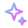
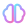
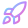
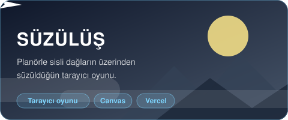
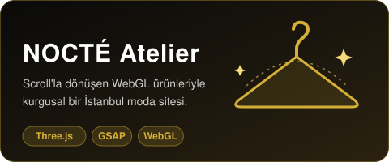
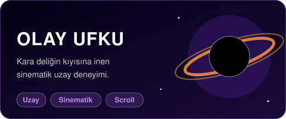
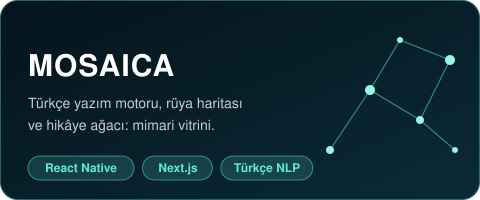
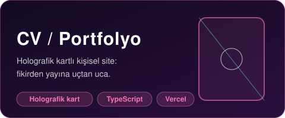
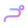

---

##  Hakkımda

**Oğuzhan Şamil Avan** · Next.js/React ile web, React Native/Expo ile mobil uygulamalar. Fikirden yayına uçtan uca ürün geliştirme. İstatistik eğitimi; veri, yazılım ve tasarımın kesişiminde işler.

-  Sinematik, scroll tabanlı ve WebGL destekli arayüzler
-  **Mosaica:** Türkçe yazım/gramer motorları ve rüya analitiği
-  Tarayıcıda oynanan küçük oyunlar ve deneyler
-  İletişim: [79kio79@gmail.com](mailto:79kio79@gmail.com)

##  Öne Çıkan Projeler

Kartlara tıklayarak canlı demolara ve repolara gidebilirsiniz.

##  Teknolojiler

##  GitHub İstatistikleri

##  Katkı Yılanı

<picture>
  <source media="(prefers-color-scheme: dark)" srcset="https://raw.githubusercontent.com/OguzZ73/OguzZ73/output/github-snake-dark.svg" />
  <source media="(prefers-color-scheme: light)" srcset="https://raw.githubusercontent.com/OguzZ73/OguzZ73/output/github-snake.svg" />
  
</picture>
Son 12 ayın katkı tablosu

